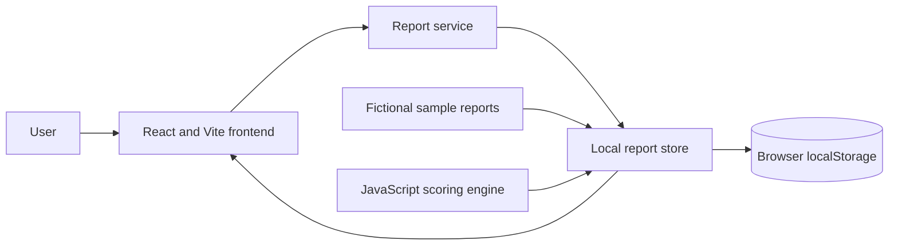
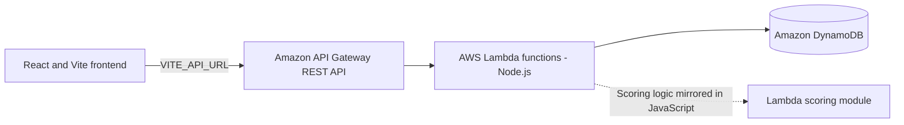

# LeakPriority

## Prioritizing Water Leak Repairs by Impact

When many leaks are reported at once, repair teams need a consistent way to decide what to inspect first. LeakPriority is a React web application that organizes water-leak reports and calculates an explainable urgency score from each report's severity, estimated flow, affected households, time unresolved, and proximity to a critical facility.

The prototype is intended for municipal water departments, utility teams, housing societies, and repair coordinators. It helps make triage decisions easier to understand; it is a decision-support tool, not a substitute for on-site inspection or qualified engineering judgment.

## Project status

### Implemented and locally testable

- Create and view leak reports, with fictional sample reports for demonstration.
- Score reports and display the score contribution from each factor.
- Sort reports by score, flow rate, household count, or unresolved time; filter by zone, status, or priority.
- Track repair work through Reported → Assigned → In Progress → Resolved.
- View dashboard counts, priority/status charts, estimated water-loss and water-savings summaries, and export filtered reports as CSV.
- Run an AWS API client path when `VITE_API_URL` is configured.

### Tested locally

- The test suite in the public repository: 19 tests passed, 0 failed in the last observed run.
- `npm run build`: production build completed successfully.
- `npm run lint`: completed with six unused-variable warnings in the last observed run.

These are local checks, not evidence of a live AWS deployment. The current frontend uses browser `localStorage` because `VITE_API_URL` is blank. The AWS SAM template and backend code are present, but **the AWS backend has not been deployed or verified**, and there is no live API endpoint.

### Awaiting deployment or future work

- Provision the API Gateway, Lambda functions, and DynamoDB table in an AWS account.
- Configure the frontend with the deployed API URL and verify live requests and persistence.
- Add authentication and authorization before using real operational or personal data.
- Add optional photo uploads only if a future workflow needs them; photo storage is not implemented.

## Key features

- Leak-report creation with form validation and an instant score preview.
- Priority score and factor-by-factor explanation.
- Sortable and filterable report table.
- Repair status workflow, technician/team assignment, and status timestamps.
- Dashboard summaries, priority distribution, status overview, and CSV export.
- Local demo persistence and sample-data reset in Local demo mode.
- Optional API-backed report operations when the API URL is configured; API mode reports failures rather than silently switching to local storage.

## How LeakPriority works

1. A user enters a leak's location, severity, estimated flow rate, affected households, and whether it is near a critical facility.
2. The application evaluates those inputs. For active reports, unresolved time is derived from the report's creation timestamp; a new report's preview starts at zero unresolved hours.
3. The scoring engine calculates a score from 0 to 100 and a contribution for each factor.
4. The report service returns active reports before resolved reports; the dashboard table sorts by priority score by default and can be sorted or filtered by the user.
5. A team can assign, start, and resolve a repair while the application records timestamps and displays estimated loss/savings summaries.

In Local demo mode, report operations use this browser's `localStorage`. With `VITE_API_URL` configured, the report service calls the API instead; a failed API request is shown as an error and does not fall back to local storage.

## Explainable priority-scoring model

The frontend and backend scoring implementations use the same prototype model. Scores are clamped to the 0–100 range; flow, household, and time contributions are rounded to one decimal place before summation.

| Factor | Maximum | Implemented calculation |
|---|---:|---|
| Severity | 30 | Critical = 30, High = 22, Medium = 14, Low = 6 |
| Estimated water-loss rate | 25 | `min(flow in L/h ÷ 200, 1) × 25`; capped at 200 L/h |
| Affected households | 20 | `min(households ÷ 500, 1) × 20`; capped at 500 |
| Time unresolved | 15 | `min(hours ÷ 72, 1) × 15`; capped at 72 hours |
| Near a critical facility | 10 | 10 when true; otherwise 0 |
| **Total** | **100** | Sum of factor points, clamped from 0 to 100 |

The category thresholds in the code are Critical 80–100, High 60–79, Medium 35–59, and Low 0–34. The implementation compares against these inclusive numeric bounds. Because scores can have decimal values, a value in a fractional gap between those integer bounds (for example, 79.5) currently falls through to the default Low category; this is an implementation edge case.

Values that parse as `NaN` or are negative score zero for that factor; the household helper parses an integer, so fractional household values are truncated. The scoring helpers use JavaScript `parseFloat`/`parseInt`; they are not, by themselves, strict input validators. Report creation validates inputs separately. These weights and thresholds are prototype choices, **not official government, utility, or engineering standards**. Showing each factor's contribution makes a recommendation easier to inspect and discuss; it does not make the score a measured risk assessment.

## Architecture

### Current, locally working data flow



### API-backed architecture in the repository, not deployed or verified

The API client and SAM infrastructure are implemented in the repository. This is the intended cloud flow, not a claim that AWS resources currently exist or that a live connection has been tested.



No S3 bucket or photo-upload flow is currently implemented.

## Technology stack

- JavaScript, React 19, and Vite 8.
- CSS for the application UI.
- Browser `localStorage` for Local demo mode.
- Node.js test script and Oxlint.
- AWS SAM template, AWS Lambda (Node.js 22 in the template), API Gateway REST API, and DynamoDB for the **planned, not-deployed** backend.

## Installation and local setup

The GitHub repository root is the application directory. Install a compatible Node.js/npm version, then use the commands for your shell.

### Windows PowerShell

```powershell
git clone https://github.com/pranavagarwal2101-byte/leakpriority.git
Set-Location .\leakpriority
npm.cmd install
npm.cmd run dev
```

Open the local URL printed by Vite (normally `http://localhost:5173/`). In another PowerShell window, run checks from the same project directory:

```powershell
npm.cmd test
npm.cmd run lint
npm.cmd run build
```

### macOS or Linux

```bash
git clone https://github.com/pranavagarwal2101-byte/leakpriority.git
cd leakpriority
npm install
npm run dev
```

In another terminal, run:

```bash
npm test
npm run lint
npm run build
```

The available package scripts are `dev`, `build`, `lint`, `test`, and `preview`. The test suite is `node test-suite.js`; it is not a separate test-runner framework.

## AWS deployment status and future deployment

The repository includes AWS SAM infrastructure and Lambda handlers for:

- **API Gateway REST API** — receives report and statistics requests.
- **AWS Lambda** — handles report operations and computes scores and dashboard statistics.
- **Amazon DynamoDB** — stores report records and repair status with on-demand billing.

The checked-in template currently allows requests from any browser origin (`AllowOrigin: '*'`) and does not configure authentication; anyone who can reach a deployed API endpoint could use its report operations. Its status-update Lambda has table-scoped DynamoDB CRUD permissions. Before deployment, restrict CORS to the intended frontend origin, review and narrow IAM permissions, and add authentication and authorization. Do not use real or sensitive data until access control is in place.

**The following deployment commands are unverified and have not been run.** AWS CLI and AWS SAM CLI were unavailable in the development environment, and AWS account access could not be checked. Deployment requires an AWS account, appropriate permissions, AWS CLI, and AWS SAM CLI. The checked-in template specifies Lambda `nodejs18.x`; confirm the runtime is supported for new deployments and update it if required. Review the template, account, region, CORS, permissions, expected costs, and retention behavior before deploying. AWS API Gateway requests, Lambda usage, DynamoDB reads/writes/storage, and logs may incur charges. The DynamoDB table is configured to be retained if the stack is deleted, so it may require separate cleanup.

For example, after installing the AWS CLI and SAM CLI, configure an IAM Identity Center profile and build/deploy from the repository root in Windows PowerShell:

```powershell
aws configure sso --profile leakpriority
aws sso login --profile leakpriority
$env:AWS_PROFILE = "leakpriority"
aws sts get-caller-identity

sam validate --template-file template.yaml
sam build --template-file template.yaml
sam deploy --guided --parameter-overrides ParameterKey=Stage,ParameterValue=dev ParameterKey=AllowedOrigin,ParameterValue=http://localhost:5173
```

These commands would create or update billable AWS resources and should only be run after reviewing the proposed deployment and approving it. A successful deployment would provide an `ApiUrl` output; placing that base URL in the ignored local `.env.local` as `VITE_API_URL=...` and restarting Vite would select API mode. Then verify requests and persistence before describing the application as connected. **No endpoint, resource, or successful AWS integration is currently available to test.**

Never place AWS access keys, session tokens, or other credentials in Vite environment variables or frontend code. Vite variables are included in browser assets; only the non-secret API base URL belongs in `VITE_API_URL`. The local `.env.local` file is excluded by `.gitignore`.

## Testing and validation

The checked-in test script checks scoring behavior and bounds, daily-loss and resolved-savings formulas, frontend/backend score and category parity, and the frontend repair-status workflow definitions. It does not test live AWS services.

Run:

```bash
npm test
npm run lint
npm run build
```

On Windows PowerShell, the equivalent commands in this environment are:

```powershell
npm.cmd test
npm.cmd run lint
npm.cmd run build
```

The last observed run of the public repository's test suite reported **19 tests passed, 0 failed**. The production build succeeded, and lint completed with six unused-variable warnings. These local checks do not exercise deployed Lambda functions, API Gateway, or DynamoDB.

For a manual local smoke test, start the frontend and confirm the Local demo mode label; create a report, inspect its score breakdown, change its repair status, refresh the page, and confirm that the change persists in the same browser. Try the table's score sorting and filters, dashboard metrics, analytics view, and CSV export. A future live AWS test should repeat these checks with the API configured and verify that creating/updating a report persists in DynamoDB across refreshes. That cloud test has not been performed.

## Limitations and future improvements

- Deploy the SAM stack and verify the API, Lambda handlers, CORS, and DynamoDB persistence end to end.
- Add authentication and authorization before any non-demo use.
- Restrict the checked-in wildcard CORS setting and review the status handler's DynamoDB permissions before deployment.
- Add automated tests for API handler behavior against a local or isolated test database.
- Review decimal category-boundary behavior in the scoring model.
- Add optional leak-photo uploads if the workflow requires them.
- Replace rough flow-rate estimates with measured or better-supported operational data.
- Consider audit history and operational analytics for repair teams.

These are future improvements, not current capabilities unless stated elsewhere as implemented.

## Responsible estimation

The dashboard estimates active daily water loss as:

```text
estimated litres per day = reported flow rate (L/h) × 24
```

For resolved reports with valid flow and timestamps, estimated water saved is:

```text
estimated litres saved = reported flow rate (L/h) × elapsed hours
```

The elapsed time is from report creation to resolution. These calculations assume the reported leak flow continued at a constant rate for the interval. The application does not measure water flow; displayed losses and savings are estimates, not verified or guaranteed real-world impact.

## Hackathon context and acknowledgements

LeakPriority is a hackathon prototype for the **WeMakeDevs × AWS Environmental Hacks**, **Heat and Water** track. AI coding assistance was used during development and documentation. The implementation has been reviewed and locally tested to the extent described above; AWS deployment and cloud behavior remain unverified.
